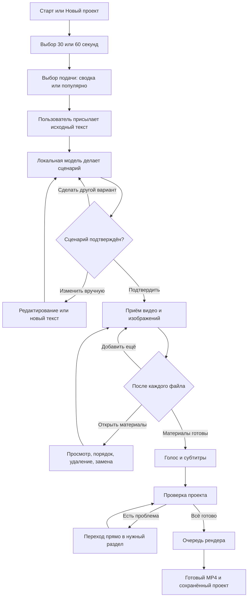
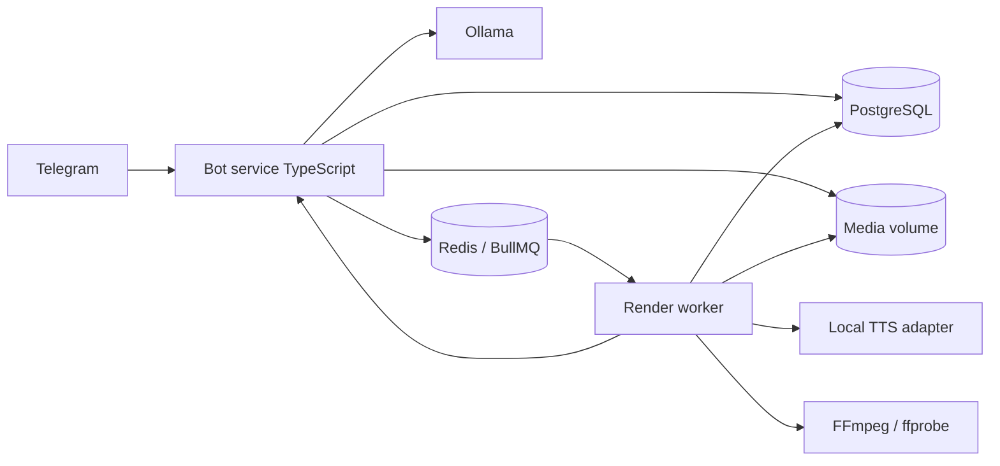

# Telegram-бот для сборки вертикальных новостных видео

## 1. Что строим

Бот принимает исходный текст новости, превращает его в короткий сценарий на 30 или 60 секунд, принимает видео и изображения, позволяет вручную менять порядок материалов, настраивать субтитры и голос, а затем собирает готовый ролик 9:16 для TikTok.

Главный принцип интерфейса: у пользователя всегда есть один активный проект, а внизу чата всегда доступны его **материалы** и **текст**. Никакая операция не должна запирать пользователя в тупиковом шаге.

Старую веб-панель в целевом варианте удаляем. Сохраняем полезную серверную основу: PostgreSQL, Redis/BullMQ, Ollama, FFmpeg, очередь рендера и локальное хранилище медиа.

## 2. Постоянная навигация

Постоянная Reply Keyboard внизу чата:

```text
[ 🎞 Материалы ] [ 📝 Текст ]
[ ⚙️ Настройки ] [ 📁 Проекты ]
[ 🚀 Собрать видео ]
```

- `🎞 Материалы` — открыть текущий набор футажей и управление им.
- `📝 Текст` — показать исходник, финальный сценарий, число слов и ожидаемую длительность.
- `⚙️ Настройки` — длительность, стиль текста, голос и оформление субтитров.
- `📁 Проекты` — законченные, незаконченные и создание нового проекта.
- `🚀 Собрать видео` — проверка готовности и постановка рендера в очередь.

Reply Keyboard нужна только для глобальной навигации. Все действия над конкретным текстом, футажом или настройкой выполняются Inline Keyboard под соответствующим сообщением, чтобы не засорять чат командами.

## 3. Основной пользовательский флоу



### 3.1. `/start`

Если проекта ещё нет:

```text
Я соберу вертикальное видео из вашей новости.
Сначала выберите длительность.

[ 30 секунд ] [ 60 секунд ]
```

Если есть незаконченный проект:

```text
Продолжить «Проект 12»?
Текст: готов · Материалы: 6 · Рендер: не запускался

[ Продолжить ] [ Новый проект ] [ Все проекты ]
```

### 3.2. Подготовка текста

После выбора длительности бот предлагает подачу:

- **Новостная сводка** — нейтрально, факты впереди, без кликбейта и оценочных добавлений.
- **Популярная подача** — сильный первый тезис, разговорнее и динамичнее, но без выдуманных фактов.

Пользователь присылает сухой исходник. Бот сохраняет его без изменений и создаёт отдельную версию сценария.

Ответ бота:

```text
Сценарий готов
67 слов · ориентировочно 28–30 секунд · подача «Новостная сводка»

<готовый сценарий>

[ ✅ Подтвердить ] [ ✏️ Исправить ]
[ 🔁 Другой вариант ] [ 🎭 Сменить подачу ]
```

После ручного исправления бот пересчитывает слова и прогноз длительности, но не переписывает текст автоматически без отдельного нажатия.

### 3.3. Как подгонять текст под длительность

Количество слов — быстрый ориентир, но финальным ограничителем должна быть реальная длительность синтезированной речи.

1. Для каждого голоса храним измеренную скорость речи в словах в минуту.
2. Начальный бюджет считаем как `длительность × скорость`, с небольшим запасом на паузы.
3. Модель получает целевой диапазон слов и строгий запрет добавлять факты.
4. После генерации делаем черновую озвучку и измеряем WAV через `ffprobe`.
5. Если звук длиннее целевого окна, просим модель ужать только лишнее и повторяем проверку. Не более двух автоматических итераций.

Стартовые ориентиры для приятного женского голоса:

- 30 секунд: примерно 58–68 слов;
- 60 секунд: примерно 118–136 слов.

Это не жёсткие константы: после подключения выбранного голоса бот калибрует диапазон по фактической скорости. Цель — около 28–29 секунд для пресета 30 секунд и 57–59 секунд для пресета 60 секунд, чтобы ролик не вышел за лимит из-за пауз и склеек.

Правила промпта для модели:

- использовать только факты из исходника;
- не придумывать причины, цитаты, цифры, оценки и последствия;
- сохранить имена, должности, даты, числа и смысл цитат;
- раскрывать сокращения, которые TTS может прочитать неправильно;
- писать для произнесения вслух, короткими фразами;
- вернуть JSON: сценарий, число слов, список удалённых второстепенных деталей;
- для популярной подачи разрешить энергичный хук, но не кликбейт, которого нет в исходнике.

Рекомендуемая локальная модель: начать с уже поддерживаемой Ollama и заменить `qwen2.5:3b` на более сильную доступную модель после теста на серверном железе. Базовый кандидат — Qwen 3/3.5 класса 4B; при достаточной памяти — 8B/9B. Выбор фиксируется бенчмарком на 30 реальных новостях: фактическая точность, попадание во время и скорость ответа важнее названия модели.

### 3.4. Загрузка материалов

Бот принимает `video`, `photo` и медиа, отправленное как `document`. Исходник сразу копируется в серверное хранилище; Telegram `file_id` сохраняется только как дополнительная ссылка, а не как единственное место хранения.

После каждого одиночного файла:

```text
Добавлено: футаж 4 из 6
Видео · 00:12 · 1080×1920

[ ➕ Добавить ещё ] [ ✅ Материалы готовы ]
[ 👁 Открыть материалы ] [ 🗑 Удалить этот ]
```

После альбома бот отвечает один раз на всю пачку: сколько файлов принято и какие отклонены. Затем снова ждёт либо новые файлы, либо подтверждение.

Обратная связь при приёме:

- файл принят и его номер в текущем порядке;
- тип, длительность и разрешение;
- предупреждение о слишком низком разрешении, битом файле или неподдерживаемом кодеке;
- для горизонтального материала — предупреждение, что он будет обрезан под 9:16;
- защита от случайного дубля по хешу файла.

Для крупных исходников на сервере стоит поднять локальный Telegram Bot API: официальный Telegram-клиент для ботов имеет более жёсткие ограничения, а локальный Bot API позволяет принимать значительно более крупные файлы и отдавать их по локальному пути.

### 3.5. Просмотр и ручной порядок футажей

В обычном Telegram-чате не нужен отдельный Web App. Бот показывает один материал за раз и редактирует это же сообщение:

```text
Материал 3 из 7
news_03.mp4 · видео · 8.4 сек
Позиция в ролике: 3

[ ◀️ Предыдущий ] [ Следующий ▶️ ]
[ ⬆️ Раньше ]     [ Позже ⬇️ ]
[ ✂️ Параметры ]  [ 🔄 Заменить ]
[ 🗑 Удалить ]    [ ✅ Готово ]
```

- `Раньше/Позже` меняют `position` и сразу обновляют номер.
- На границах списка соответствующая стрелка выключается.
- `Заменить` переводит бота в ожидание одного нового файла, сохраняя позицию старого.
- `Удалить` требует короткого подтверждения; после удаления позиции пересчитываются транзакционно.
- `Параметры` в MVP позволяет задать точку начала видео. Позже сюда можно добавить длительность показа и кадрирование.
- `Список` можно вывести отдельным текстовым сообщением с номерами и именами, но основное управление остаётся в просмотрщике.

Порядок пользователя является главным. Автомонтаж не переставляет материалы: он только распределяет их по длительности озвучки.

### 3.6. Распределение материалов по ролику

- Общая длительность равна фактической длительности озвучки.
- Материалы идут строго в заданном порядке.
- В MVP время делится между материалами равномерно с разумными минимальными и максимальными отрезками.
- Длинное видео обрезается от выбранной точки начала.
- Короткое видео зацикливается или замедляется только в безопасном диапазоне; бот показывает предупреждение.
- Изображение получает лёгкий плавный zoom/pan.
- Если материалов мало, они повторяются по кругу; перед рендером бот явно предупреждает об этом.
- Если материалов очень много, каждому не должно доставаться меньше минимального читаемого отрезка; бот предлагает удалить лишние.

Следующая итерация после MVP: разбить сценарий на смысловые сцены и позволить назначить футаж конкретной сцене, сохраняя ручной порядок как исходный.

### 3.7. Голос

Отдельный экран:

```text
Голос озвучки
● Ирина — женский, спокойный (по умолчанию)
○ Ксения — женский, деловой
○ Дмитрий — мужской, нейтральный

[ ▶️ Послушать Ирину ]
[ Ирина ] [ Ксения ] [ Дмитрий ]
[ ✅ Сохранить ]
```

Каждая кнопка прослушивания отправляет короткий заранее подготовленный аудиосэмпл. Для первого релиза можно оставить существующий локальный Piper и его русские голоса; если качество не устраивает, заменить TTS-адаптер на Silero, не меняя бот и рендер.

### 3.8. Шрифт, цвет и размер

Настройки субтитров:

- шрифт из серверного белого списка;
- размер: `S`, `M`, `L` плюс точное значение в допустимом диапазоне;
- цвет текста из 6–8 контрастных пресетов;
- обводка/фон задаются автоматически для читаемости;
- позиция пока фиксирована в безопасной нижней трети кадра.

После любого изменения бот генерирует JPEG-превью 1080×1920 с примером реального текста и кнопками:

```text
[ Шрифт ] [ Цвет ] [ Размер ]
[ 👁 Обновить пример ] [ ✅ Сохранить ]
```

В MVP не принимать произвольные файлы шрифтов от пользователей: это усложняет лицензирование, безопасность и предсказуемость рендера. Новые шрифты добавляет администратор на сервере.

### 3.9. Проверка и генерация

Перед постановкой в очередь бот показывает снимок проекта:

```text
Проект готов к сборке
Формат: 1080×1920, MP4, 30 fps
Текст: 64 слова, озвучка 28.7 сек
Материалы: 7
Голос: Ирина
Субтитры: Inter Bold, белые, M

[ 🚀 Начать сборку ] [ 📝 Текст ]
[ 🎞 Материалы ] [ ⚙️ Настройки ]
```

После подтверждения создаётся неизменяемый snapshot всех настроек и порядка футажей. Изменения активного проекта после запуска не должны влиять на уже идущий рендер.

Прогресс обновляется в одном сообщении:

```text
Собираю видео: 62%
Озвучка ✓ · Подготовка кадров ✓ · Рендер 5/8

[ Отменить ]
```

Результат:

- готовый MP4 отправляется видеофайлом;
- остаются кнопки `Скачать файлом`, `Собрать заново`, `Дублировать проект`, `Новый проект`;
- проект получает статус `completed`, но остаётся редактируемым через дубликат, чтобы готовая версия не менялась задним числом.

## 4. История проектов

Экран `📁 Проекты`:

```text
[ ➕ Новый проект ]
[ 🟡 Незаконченные ] [ ✅ Готовые ]
```

Карточка проекта:

```text
Проект 12 · 30 сек · 01.11.2026
Статус: материалы 6/?, сценарий готов

[ Продолжить ] [ Дублировать ]
[ Переименовать ] [ Удалить ]
```

Статусы:

- `draft` — проект создан, текст ещё не подтверждён;
- `collecting_assets` — текст готов, материалы добавляются;
- `ready` — все обязательные данные есть;
- `rendering` — идёт сборка;
- `completed` — есть успешный результат;
- `failed` — последняя сборка упала, проект можно продолжить;
- `archived` — мягко удалён пользователем.

Список пагинируется кнопками, а не отправляет десятки сообщений. Удаление проекта сначала мягкое; физическая очистка файлов выполняется отдельной фоновой задачей после срока восстановления.

## 5. CRUD

| Сущность | Create | Read | Update | Delete |
|---|---|---|---|---|
| Проект | Новый проект | Карточка и списки по статусу | Имя, пресет, настройки, активный проект | Мягкое удаление с подтверждением |
| Исходный текст | Первое сообщение с текстом | Экран `📝 Текст` | Полная замена исходника | Очистка только до подтверждения |
| Версия сценария | Генерация моделью или ручной ввод | Текущая и предыдущие версии | Ручная правка, новая генерация | Удаление версии, кроме активной |
| Футаж | Загрузка/замена | Просмотрщик и список | Позиция, начало, подпись, параметры кадра | Удаление с пересчётом порядка |
| Настройки | Значения по умолчанию при создании | Экран настроек | Длительность, стиль, голос, субтитры | Сброс к значениям по умолчанию |
| Рендер | Запуск из snapshot проекта | Статус и история результатов | Только отмена queued/processing | Мягкая очистка результата |

Все изменения проверяют владельца проекта по `telegram_user_id`. На уровне базы порядок футажей меняется одной транзакцией, чтобы не появились две одинаковые позиции.

## 6. Состояния диалога

FSM хранится на сервере, а не только в памяти процесса:

- `idle`;
- `awaiting_source_text`;
- `awaiting_script_edit`;
- `awaiting_assets`;
- `awaiting_replacement_asset(asset_id)`;
- `awaiting_project_name`;
- `choosing_voice`;
- `choosing_caption_style`;
- `confirming_render`.

Глобальные кнопки `Материалы`, `Текст`, `Настройки`, `Проекты` доступны из любого состояния. После просмотра пользователь возвращается в прежнее состояние ожидания. `/cancel` отменяет только текущий ввод, но не удаляет проект.

Каждое входящее Telegram-обновление обрабатывается идемпотентно: `update_id` записывается в базу. Повторный callback не должен второй раз удалить файл, сдвинуть позицию или создать ещё один render job.

## 7. Предлагаемая архитектура



Сервисы Docker Compose:

1. `bot` — long polling или webhook, обработчики Telegram, FSM и прикладные сервисы.
2. `worker` — TTS, субтитры, подготовка футажей и FFmpeg-рендер.
3. `postgres` — пользователи, проекты, версии, футажи, настройки и jobs.
4. `redis` — очередь и блокировки.
5. `ollama` — локальная переработка текста.
6. `telegram-bot-api` — рекомендуется для крупных видео; можно включить вторым этапом.

Fastify можно оставить только для `/health`, webhook и внутренних диагностических endpoints. Публичная веб-панель и браузерный CORS больше не нужны.

Предлагаемая структура кода:

```text
apps/
  bot/
    src/handlers/       # команды, сообщения, callback-кнопки
    src/keyboards/      # reply и inline keyboards
    src/conversations/  # FSM
    src/services/       # projects, scripts, assets, settings, renders
  worker/
    src/jobs/           # voiceover, captions, render
packages/
  domain/               # типы, статусы, правила и ошибки
  db/                   # запросы и миграции
  media/                # ffprobe, безопасные пути, metadata
  text/                 # Ollama adapter и prompts
```

Для минимальной переделки можно сначала оставить текущий `apps/api` и добавить в него Telegram-слой, но целевая структура выше лучше разделяет быстрые ответы бота и тяжёлый рендер.

## 8. Схема данных

### `users`

- `id UUID`;
- `telegram_user_id BIGINT UNIQUE`;
- `telegram_chat_id BIGINT`;
- `current_project_id UUID NULL`;
- `role user|admin`;
- `created_at`, `updated_at`.

### `projects`

- `id`, `owner_id`, `title`;
- `status`;
- `target_duration_sec` — 30 или 60;
- `delivery_style` — `news` или `popular`;
- `source_text`;
- `active_script_version_id`;
- `voice_id`;
- `caption_style JSONB`;
- `created_at`, `updated_at`, `archived_at`.

### `script_versions`

- `id`, `project_id`, `version_no`;
- `text`;
- `word_count`;
- `estimated_duration_sec`;
- `measured_duration_sec`;
- `origin` — `llm` или `manual`;
- `model`, `prompt_version`;
- `created_at`.

### `assets`

- `id`, `project_id`, `position`;
- `kind` — `video` или `image`;
- `storage_key`, `telegram_file_id`, `sha256`;
- `original_name`, `mime_type`, `size_bytes`;
- `width`, `height`, `duration_sec`;
- `trim_start_sec`, `display_duration_sec`;
- `status` — `processing`, `ready`, `invalid`, `deleted`;
- `created_at`, `deleted_at`.

Ограничение: уникальная активная позиция внутри проекта. Для перестановки использовать транзакцию и временную позицию либо атомарное перенумерование.

### `render_jobs`

- `id`, `project_id`, `status`, `stage`, `progress`;
- `snapshot JSONB`;
- `output_key`, `error_code`, `error_message`;
- `cancel_requested_at`;
- `created_at`, `started_at`, `finished_at`.

### Справочники

- `voices` — имя, движок, model key, пол, темп, sample key, enabled;
- `fonts` — имя, путь, допустимые размеры, enabled;
- `processed_updates` — Telegram `update_id` и время обработки.

## 9. Надёжность и безопасность

- На старте ограничить доступ белым списком Telegram ID, если бот внутренний.
- Не писать bot token, полный исходный текст и callback payload в обычные логи.
- Проверять фактический тип медиа через `ffprobe`, а не доверять расширению.
- Ограничить число файлов, общий объём проекта и параллельные рендеры на пользователя.
- Все пути строить на сервере из UUID; исходное имя никогда не использовать как путь.
- Рендер запускать отдельным непривилегированным worker-процессом.
- Делать резервные копии PostgreSQL и media volume.
- Хранить понятные коды ошибок и давать пользователю кнопку повторить упавший этап.
- Сохранять snapshot рендера и версии промптов для воспроизводимости результата.
- Вводить retention: например, черновики и исходники не удалять автоматически до согласованного срока.

## 10. Что удалить и что переиспользовать

### Удалить после переноса

- `apps/web` целиком;
- поиск стоковых материалов и экран библиотеки, если загрузка будет только пользовательская;
- браузерные CORS-настройки и SSH-туннель для панели;
- API маршруты, существующие только ради веб-интерфейса.

### Переиспользовать и доработать

- Docker Compose;
- PostgreSQL и миграции;
- Redis/BullMQ;
- Ollama;
- текущий Piper `irina` как голос по умолчанию;
- FFmpeg-сборку 1080×1920, 30 fps, H.264/AAC;
- генерацию ASS-субтитров;
- stage/progress модель render job;
- media volume.

Старый проект не сносить первым коммитом. Сначала завести новую схему и минимальный сквозной сценарий, проверить готовый MP4 через Telegram, после чего удалить веб-часть и неиспользуемые маршруты отдельным коммитом. Так проще сравнивать старый и новый рендер и откатиться при проблеме.

## 11. Этапы разработки

### Этап 0. Фиксация исходного состояния

- сохранить текущий рабочий вариант отдельным git-тегом/веткой;
- собрать один контрольный ролик;
- зафиксировать серверное железо, свободную память/GPU и размеры диска;
- получить bot token и список разрешённых Telegram ID.

Результат: есть точка отката и эталон старого рендера.

### Этап 1. Каркас бота и проекты

- сервис бота в Docker Compose;
- `/start`, постоянная клавиатура, пользователи;
- создание, продолжение, список и мягкое удаление проектов;
- FSM и идемпотентность Telegram updates;
- миграции новой схемы.

Результат: проект можно создать, закрыть чат и продолжить после перезапуска сервера.

### Этап 2. Текстовый конвейер

- выбор 30/60 секунд и стиля;
- хранение исходника и версий;
- Ollama prompt с JSON schema;
- подсчёт слов, оценка времени, черновой TTS и автоматическая доводка;
- ручное редактирование и повторная генерация.

Результат: подтверждённый сценарий стабильно попадает в выбранную длительность и не меняет факты в тестовом наборе.

### Этап 3. Футажи и CRUD

- приём одиночных файлов и альбомов;
- локальное сохранение, hash, `ffprobe`, thumbnails;
- обратная связь после каждой загрузки;
- просмотрщик, перестановка, замена и удаление;
- обработка ожидания нового файла без потери состояния.

Результат: пользователь полностью управляет материалами только через Telegram.

### Этап 4. Голоса и субтитры

- каталог голосов и аудиосэмплы;
- Piper adapter с голосом `irina` по умолчанию;
- шрифты, цвет, размер;
- генерация изображения-превью субтитров;
- хранение настроек в проекте.

Результат: все визуальные и голосовые настройки проверяются до рендера.

### Этап 5. Рендер и выдача результата

- snapshot проекта;
- новая timeline-логика с ручным порядком;
- прогресс в одном Telegram-сообщении;
- отмена и повтор failed jobs;
- отправка готового MP4;
- история результатов.

Результат: сквозной сценарий `текст → файлы → настройки → MP4` работает без веб-панели.

### Этап 6. Уборка и эксплуатация

- удалить `apps/web`, stock search и устаревшие API;
- health checks, структурированные ошибки, мониторинг диска и очереди;
- backup/restore тест;
- локальный Telegram Bot API для больших файлов;
- нагрузочный тест очереди и ограничение параллельных jobs;
- короткая инструкция для редактора.

Результат: старый интерфейс удалён, бот готов к постоянной работе на сервере.

## 12. Приёмка MVP

MVP считается готовым, если пользователь может без команд и внешней панели:

1. Создать проект и выбрать 30 или 60 секунд.
2. Получить два типа подачи и подтвердить сценарий.
3. В любой момент открыть текущий текст и текущие материалы нижними кнопками.
4. Добавить видео/изображения по одному или альбомом и получить обратную связь.
5. Поменять порядок, заменить и удалить любой футаж.
6. Выбрать голос, шрифт, цвет и размер, увидеть превью.
7. Запустить рендер и видеть понятный прогресс.
8. Получить воспроизводимый вертикальный MP4 с озвучкой и субтитрами.
9. Вернуться к незавершённому проекту после перезапуска бота.
10. Открыть историю законченных и незаконченных проектов.

## 13. Решения, которые лучше принять до начала кода

Осталось подтвердить только три продуктовых ограничения:

1. Бот внутренний по белому списку Telegram ID или публичный для любых пользователей.
2. Максимальный размер одного файла и суммарный объём проекта на сервере.
3. Достаточно ли в MVP равномерного распределения футажей по длительности, или сразу нужен ручной выбор длительности каждого фрагмента.

Остальное можно реализовывать без дополнительных продуктовых развилок.
